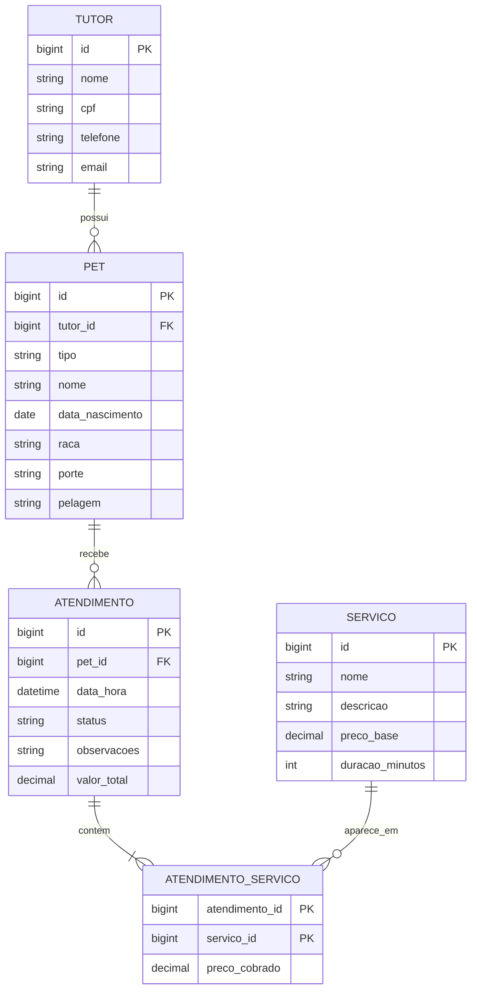

# Pet Shop API

API REST em Java puro (sem frameworks) para gestão de um pet shop de banho e tosa. Trabalho Semestral, Entrega 2.

**Aluna:** Beatriz Sthefanny Araujo Santos
**Instituição:** FATEC São José dos Campos, Prof. Jessen Vidal

## Tecnologias

Java 21, Maven, H2 embarcado **em arquivo** (não in-memory), `HttpServer` do JDK e Gson (JSON). Nenhum framework.

## Modelo de dados



- **1..N:** Tutor → Pets e Pet → Atendimentos.
- **N..N:** Atendimento ↔ Serviço, pela tabela `atendimento_servico`.
- Cachorros e gatos ficam na tabela `pet` (coluna `tipo`): `porte` vale para cachorros e `pelagem` para gatos.

## Pilares da OO

- **Abstração:** `Pet` é abstrata e define `calcularAdicional()`.
- **Encapsulamento:** atributos privados e setters com validação (CPF, e-mail, preço, datas).
- **Herança:** `Cachorro` e `Gato` herdam de `Pet`; todas as entidades herdam de `BaseEntity`.
- **Polimorfismo:** cada espécie sobrescreve `calcularAdicional()`; além disso, `CrudRepository<T>` e `Controller` são interfaces com várias implementações.

**Regra de preço:** preço cobrado = preço base do serviço + adicional do pet.
Cachorro: pequeno +R$ 0, médio +R$ 15, grande +R$ 30. Gato: pelagem curta +R$ 0, longa +R$ 20.

## Como executar

Pré-requisitos: JDK 21+ e Maven 3.9+ (`java -version` e `mvn -v`).

```bash
git clone <URL-DO-REPOSITORIO>
cd petshop-api
mvn clean compile
mvn exec:java
```

A API sobe em `http://localhost:8080` (teste em `/health`). O banco é criado em `./data/` e os dados persistem; para zerar, pare a aplicação e apague a pasta `data/`. Porta alternativa: `mvn exec:java -Dpetshop.port=9090`.

## Endpoints

| Recurso | Rotas |
|---|---|
| Tutores | `GET/POST /tutores`, `GET/PUT/DELETE /tutores/{id}`, `GET /tutores/{id}/pets` |
| Pets | `GET/POST /pets`, `GET/PUT/DELETE /pets/{id}`, `GET /pets/{id}/atendimentos` |
| Serviços | `GET/POST /servicos`, `GET/PUT/DELETE /servicos/{id}` |
| Atendimentos | `GET/POST /atendimentos`, `GET/PUT/DELETE /atendimentos/{id}` |
| Serviços do atendimento | `POST /atendimentos/{id}/servicos`, `DELETE /atendimentos/{id}/servicos/{servicoId}` |

Erros retornam `{"erro": "mensagem"}` com os códigos 400 (dado inválido), 404 (não encontrado) e 409 (conflito, como CPF duplicado ou serviço repetido).

## Exemplo de uso

```bash
curl -X POST http://localhost:8080/tutores -H "Content-Type: application/json" -d '{"nome":"Maria Santos","cpf":"529.982.247-25"}'
curl -X POST http://localhost:8080/pets -H "Content-Type: application/json" -d '{"tipo":"CACHORRO","tutorId":1,"nome":"Thor","porte":"GRANDE"}'
curl -X POST http://localhost:8080/servicos -H "Content-Type: application/json" -d '{"nome":"Banho","precoBase":50.00,"duracaoMinutos":45}'
curl -X POST http://localhost:8080/atendimentos -H "Content-Type: application/json" -d '{"petId":1,"dataHora":"2026-11-10T14:30","servicoIds":[1]}'
```

No PowerShell, use `curl.exe` e escape as aspas do JSON (`-d "{\"nome\":\"Maria\"}"`). O CPF precisa ser válido; `529.982.247-25` serve para testes. O último comando retorna `valorTotal` 80.00 (R$ 50 + R$ 30 do cachorro grande).
